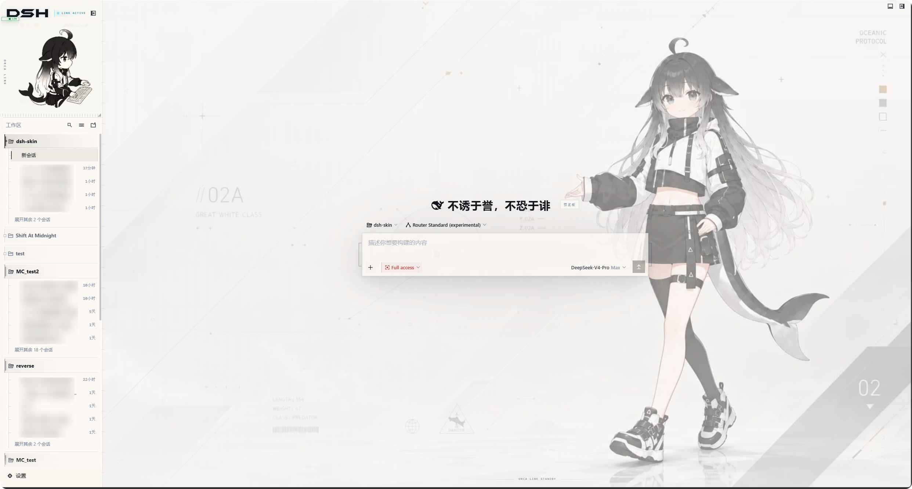
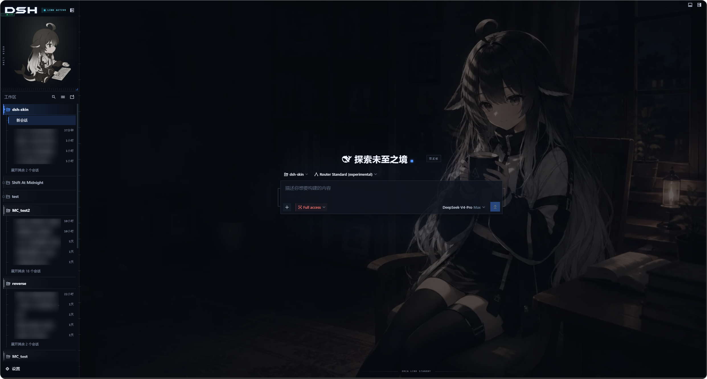

# DSH-深鲸-LM · 虎鲸链路优化版 (Fork of dsh-deep-whale)

简体中文 · [English](README.en.md) · [Tiếng Việt](README.vi.md)

> ⚠️ **注意**：本仓库是基于上游 [`Small-tailqwq/dsh-deep-whale`](https://github.com/Small-tailqwq/dsh-deep-whale) 的二次改造版。
> **主要变更**：移除了 `maid-atelier` (女仆工坊)，仅保留 `orca-link` (虎鲸链路) 与 `skin-manager` (皮肤管理器)。
> **现已上架 npm！** 无需再使用复杂的 Git 链接，直接搜索包名即可一键安装。

给 DeepSeek Harness（DSH）Web 界面换上酷酷的虎鲸链路主题，附带一个用来切换皮肤的管理面板。

## 效果预览

点击图片可查看完整尺寸。

| 皮肤 | 亮色模式 | 暗色模式 |
| --- | --- | --- |
| orca-link |  |  |

## 住户

| 皮肤 | 包名 (npm) | 说明 | 许可 |
| --- | --- | --- | --- |
| [orca-link](orca-link/) | @kmjjkuu/dsh-client-ui-skin-deep-whale-lm-orca-link | 虎鲸链路：酷酷的小黑鲸操作员，全直角界面加用直线重绘的图标；亮色机能，暗色治愈 | MIT (code) / CC BY-NC-SA 4.0 (artwork) |
| [skin-manager](skin-manager/) | @kmjjkuu/dsh-client-ui-skin-deep-whale-lm-manager | 皮肤管理器：切换已安装的皮肤，调整各皮肤自带的选项，在「设置 → 皮肤管理」中打开 | MIT |

## 版权所有人

| 版权所有人 | 版权所有内容 | 对应皮肤 | 个人主页 |
| :--- | :--- | --- | :--- |
| 上善 | 鲸鱼娘角色形象原作 | orca-link | [Pixiv](https://www.pixiv.net/users/62155430) · [Bilibili（上善无形）](https://b23.tv/8h5L4xz) |
| **kmjjkuu** | **DSH 0.2.0+ 兼容性修复、配置规范化及本地化适配** | **orca-link / skin-manager** | **[GitHub](https://github.com/kmjjkuu)** |

*反馈问题尽可能在 issue 中发起，而不是跑去联系原作者。但是，看鲸鱼娘二创可以去关注一下，谢谢喵*

## 安装

[!NOTE]
如果你用的是 dsh-web（装过 `@linxin666/dsh-web-all`），请直接在 dsh-web 自带的皮肤中心里安装 `orca-link`，不要再运行下面的命令。两边的皮肤是分别适配的，装在同一个 profile 里会让界面显示错乱。

现在推荐直接从 **npm** 安装，速度更快且更稳定。不需要 clone 仓库，也不需要懂 Git。

### 方式一：命令行安装 (推荐)

复制对应系统的命令运行即可。

#### Windows (PowerShell / CMD)
```powershell
# 1. 安装皮肤管理器 (必须先装这个)
dsh plugin --profile web add '@kmjjkuu/dsh-client-ui-skin-deep-whale-lm-manager'

# 2. 安装虎鲸链路皮肤
dsh plugin --profile web add '@kmjjkuu/dsh-client-ui-skin-deep-whale-lm-orca-link'
